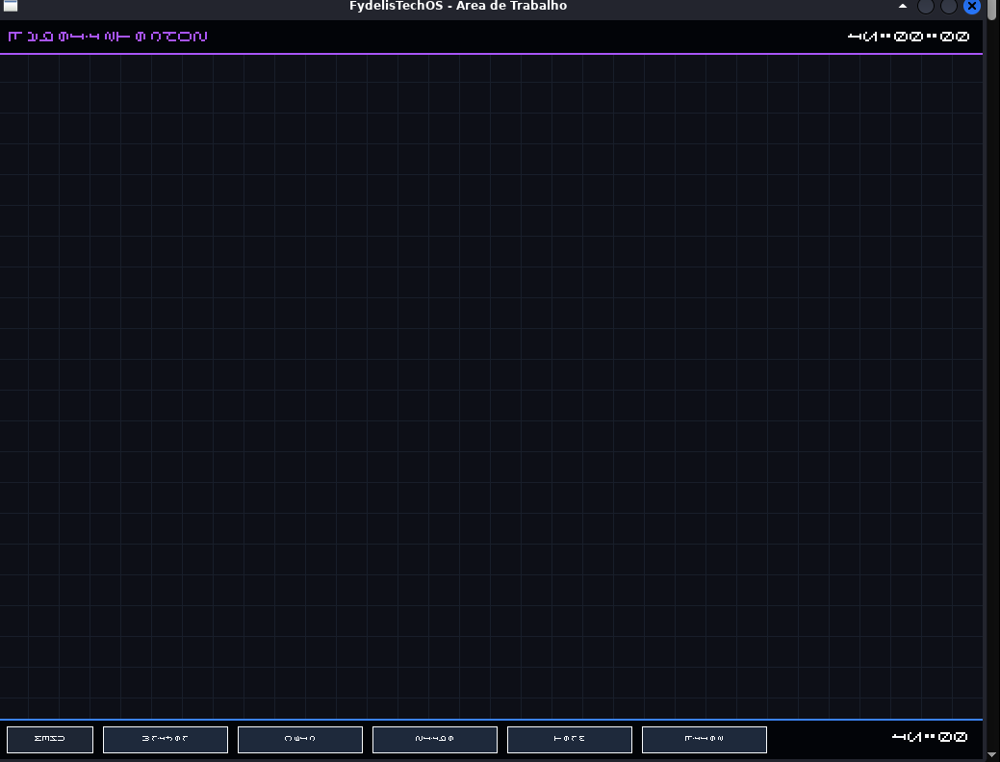

# 🖥️ FydelisTechOS — Tela Gráfica (A Tentativa que Deu Errado)

<div align="center">

[]()
[]()
[]()
[]()
[](LICENSE)

</div>

<p align="center">
  
</p>

> 
> ⚠️ **STATUS: ARQUIVADO — Para fins de estudo e humor construtivo** 💥
> Esta foi a nossa **primeira e corajosa tentativa** de construir uma interface gráfica para o FydelisTechOS.
> Funcionou parcialmente, mas não vingou. Fica aqui como registro de onde começamos.
> 
> 
> 📍 Feito em Salvador — Bahia, Brasil
> 📅 Versão 0.1 — Novembro de 2026

---

## 😂 A História Resumida

Um dia olhamos para o terminal e dissemos: *"E se a gente desenhar umas janelas?"*

Pareceu simples. Então criamos janelas, botões, barra de tarefas, área de trabalho... e também um monte de desafios que ainda não estávamos prontos para resolver. O resultado? A interface abre, mas com texto ilegível, fontes que não renderizam certo e funcionalidades incompletas. Em vez de esconder, **mantivemos aqui porque aprender também é errar.**

> 
> 📸 **A prova do crime:** Veja a captura — tem barra roxa, botões bonitos e texto que parece vindo de outra dimensão 😂

---

## 📂 Estrutura do Projeto

```
interface/src/
├── main.c              ← Ponto de entrada da aplicação
├── gui.c               ← Núcleo da interface gráfica
├── desktop.c           ← Área de trabalho / plano de fundo
├── barra_tarefas.c     ← Barra inferior com botões
├── menu_iniciar.c      ← Menu de início
├── apps.c              ← Ícones e aplicativos
├── widgets.c           ← Elementos visuais genéricos
├── retangulo.c         ← Desenho de formas
├── texto.c             ← Renderização de texto (aqui que deu problema 😅)
├── fonte.c             ← Carregamento e uso de fontes
├── icones.c            ← Ícones visuais
├── assets.c            ← Recursos visuais (imagens, etc.)
├── cores.c             ← Paleta de cores do sistema
└── ...
```

---

## ✅ O Que Conseguimos Fazer

- ✅ **Janela principal** abre e exibe corretamente
- ✅ **Barra de tarefas** na parte inferior com botões
- ✅ **Área de trabalho** com fundo em grade
- ✅ **Paleta de cores** definida e aplicada
- ✅ Estrutura modular — cada arquivo com uma responsabilidade
- ✅ **Aprendizado gigante** — este foi o maior resultado de todos!

## ❌ O Que Não Deu Certo

Tabela

| Problema | O Que Aconteceu | Por Que Aconteceu |
| --- | --- | --- |
| 🀄 **Texto ilegível** | Caracteres aparecem como símbolos estranhos | Codificação e renderização de fonte não implementadas corretamente |
| 🔘 **Botões sem ação** | Os botões existem mas não respondem | Sistema de eventos e cliques incompleto |
| 📦 **Acoplamento forte** | Difícil separar a GUI do resto do sistema | Arquitetura ainda em fase inicial de aprendizado |
| 🎨 **Layout fixo** | Elementos não se ajustam ao tamanho da janela | Sem sistema de posicionamento responsivo |
| 🚧 **Manutenção difícil** | Cada mudança exige alterar vários arquivos | Sem padrões consolidados de organização de código |

---

## 🤔 Por Que Não Seguimos Com Esta Versão?

Decidimos **arquivar esta abordagem** porque:

1. 🎯 **O foco mudou:** Priorizamos aprofundar o kernel e o terminal (FydelTerm), onde realmente dominamos o que fazemos
2. 📚 **Complexidade maior que o esperado:** Interface gráfica envolve fontes, eventos, renderização, janelas — muito para um primeiro momento
3. 💡 **Esta versão serviu ao seu propósito:** Foi um experimento valioso. Agora guardamos o aprendizado e seguimos
4. 🔭 **Futuro:** Quando voltarmos a fazer interface gráfica, será com base no que aprendemos aqui — não como tentativa, mas como plano

> 
> 💡 *"Saber parar quando ainda não está pronto é tão inteligente quanto saber começar."*

---

## 🎯 O Que Realmente Aprendemos

Mesmo "fracassando", este projeto nos ensinou mais do que muitos que funcionam de primeira:

- ✅ Como organizar um projeto em vários arquivos
- ✅ Separar responsabilidades por módulos
- ✅ Definir paleta de cores e padrões visuais
- ✅ O quanto é complexo renderizar texto corretamente
- ✅ Que **está tudo bem** construir algo que não funciona — desde que entenda por quê
- ✅ Que o verdadeiro sucesso não é o código perfeito, mas o conhecimento que ele gera

---

## 🚀 Para Onde Fomos — O Projeto Atual

Tabela

| Componente | Status Atual |
| --- | --- |
| 🔹 **FydelTerm** | ✅ Em desenvolvimento ativo — terminal funcional e documentado |
| 🔹 **Kernel** | ✅ Construindo passo a passo, linha por linha |
| 🔹 **Esta GUI antiga** | ⏳ Arquivada — fica como memória e lição de onde viemos |

---

## 📜 Mensagem Final

> 
> *"Este repositório não é sobre o que não deu certo. É sobre a coragem de tentar, a honestidade de reconhecer e a sabedoria de seguir em frente. O código aqui é imperfeito, mas o aprendizado dele é perfeito. Todo projeto tem sua versão feia — a diferença é que nós não tivemos vergonha de mostrar."*
> 
> 
> — FydelisTechos, 2026

---

*Feito na Bahia • Errar faz parte do caminho ❤️*
